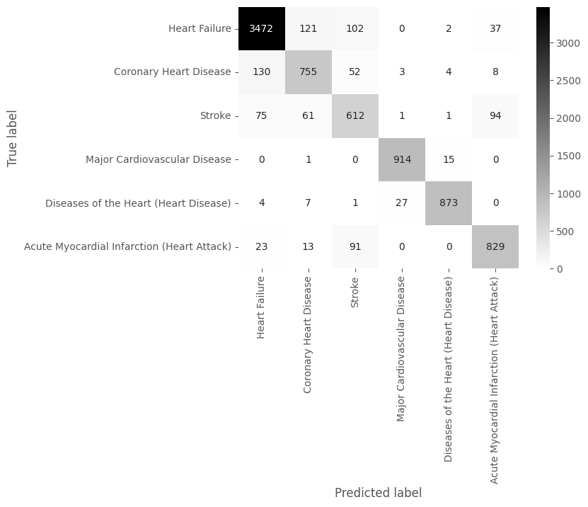

# Heart Disease & Stroke: Six-Class Classification

Machine learning project from my MSc in Artificial Intelligence and Computer Science at the University of Calabria. The goal is to predict which cardiovascular topic a record belongs to (six classes) from its indicator values and demographic breakdown.

**Best result:** a neural network (MLP) reached **0.90 accuracy** and **0.90 weighted F1** on a held-out test set.

## Data

- Source file: `heart_disease_data.csv`, 42,640 rows and 29 columns, Medicare (CMS) heart disease and stroke indicators by year and location. It is not included in this repo because of its size. Save it next to the notebooks to re-run notebook 1.
- After cleaning: `heart_disease_data_cleaned.csv`, 41,638 rows and 9 columns (included, so notebook 2 runs on its own).
- Each row is an aggregated indicator (a percentage with confidence limits for a group of people), not an individual patient.
- Target (6 classes): Heart Failure, Coronary Heart Disease, Stroke, Major Cardiovascular Disease, Diseases of the Heart, Acute Myocardial Infarction.

## Notebooks

1. `Data_Understanding_Project.ipynb`: exploration and cleaning.
   - Removed columns with more than 65% missing values.
   - Dropped constant columns and ID columns that carry no signal.
   - Removed 176 exact duplicate rows.
   - Found and removed 826 records with identical content but different topic labels, which would confuse a classifier.
   - Dropped `Data_Value`, which is nearly identical to `Data_Value_Alt`.
2. `Modelling_Project.ipynb`: preparation and models.
   - Encoded categorical columns (71 features after encoding) and scaled numeric ones.
   - Split the data into train, validation and test sets.
   - Balanced the minority classes with Borderline-SMOTE on the training data only.
   - Compared 8 models on the validation set and with 5-fold cross-validation, then evaluated the best one on the test set.

## Results

Validation accuracy of the models I compared (trained on the SMOTE-balanced training set):

| Model | Accuracy |
|---|---|
| Random Forest | 0.89 |
| Decision tree (C4.5-style, entropy) | 0.87 |
| Decision tree (CART, gini) | 0.87 |
| Gradient Boosting | 0.86 |
| Naive Bayes | 0.75 |
| k-NN | 0.53 |
| AdaBoost | 0.36 |

The neural network (MLP) was chosen as the best model on F1 and accuracy. **Test set:** accuracy 0.90, weighted F1 0.90, macro F1 0.87.


## Limitations

- The records are group-level statistics, so this shows the method, not a tool to diagnose anyone.
- Two classes (Coronary Heart Disease and Stroke) are the hardest, with F1 around 0.72 to 0.79.
- Results come from one random split, seed 12062024.

## How to run

```bash
pip install -r requirements.txt
jupyter notebook
```

Open `Modelling_Project.ipynb` and run all cells.

## Tools

Python, pandas, NumPy, scikit-learn, imbalanced-learn, seaborn, matplotlib.
